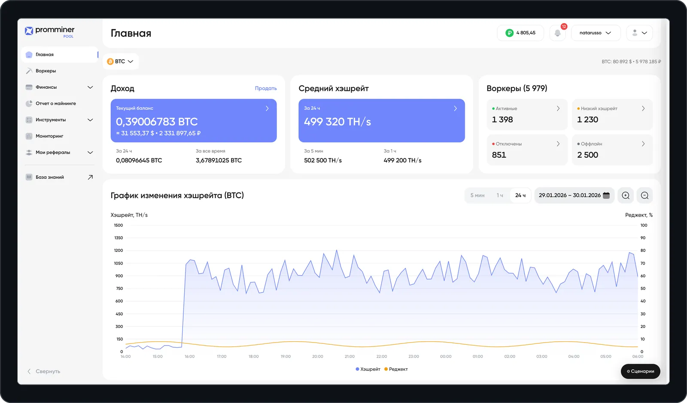

# Web Prototype Pool

Правдоподобный веб-прототип личного кабинета майнинг-пула для команды продукта: прогоняет фичи и сценарии, которые не воспроизвести на проде с пустым аккаунтом.

<a href="https://github.com/egorovdnikita/web-prototype-pool"></a>

## Что умеет

- **Весь кабинет.** Главная, воркеры, финансы, отчёт о майнинге, калькуляторы, мониторинг, рефералы, профиль и вход — по макетам Figma.
- **Сценарии в ссылке.** Панель «Сценарии» (кнопка внизу справа или клавиша `S`) переключает монету, наполнение данными, здоровье парка, роль, верификацию и другие оси; состояние живёт в хэше, и любую комбинацию можно скинуть одним URL.
- **Стиль.** Шрифт, акцент, скругления, отступы, набор иконок и тонкая настройка токенов; оформление сохраняется темой, сравнивается с дизайн-системой и выгружается в Design Tokens JSON.
- **Чат.** Включает состояния и меняет оформление словами («авария на парке», «фон темнее»); работает локально, модель за прокси — по желанию.
- **Черновики разделов.** Чат собирает новый экран из блоков дизайн-системы — песочница с пометкой «черновик», вне макетов.
- **Тёмная тема** и шрифт Gilroy, как в продукте.
- **Проверки.** `npm run sweep` рендерит все экраны × модалки × значения осей (29 110 комбинаций), `npm run audit` ищет мёртвые оси, обработчики и пиксели мимо токенов.

## Запуск

Нужен Node 20.19+ или 22.12+.

```bash
npm install
npm run dev
```

Открой `http://localhost:5173`. Такие версии Node требует Vite 8. Сборка и проверка типов — `npm run build`, проверки перед коммитом — `npm run sweep`, `npm run panel`, `npm run audit`. Пароль на вход задаётся `npm run gate`; без него прототип открывается сразу.

## Стек

React · TypeScript · Vite · TanStack Router · Tailwind · Cloudflare Workers

## Устройство

```
src/
  routes/               файловые маршруты: каркас, Главная, разделы
  state/store.tsx       сценарий и интерфейс, делегированный обработчик кликов, хэш-ссылка
  components/           каркас в React: сайдбар, хедер, модалки, панель сценариев
  legacy/prototype.js   движок: данные, иконки, экраны, модалки — переезжает в TSX по одному
  chat.ts · ai.ts       локальный разбор чата и проверка ответа модели
worker/                 прокси для модели (ключ живёт там, а не в репозитории)
scripts/                sweep, panel, audit, gate, catalog, иконки
```

Подробнее — в [обзоре](docs/overview.md) и [паспорте проекта](CLAUDE.md).

## Документация

- [Паспорт проекта](CLAUDE.md) — правила и устройство
- [Журнал аудитов](docs/AUDIT_LOG.md) — что проверено и исправлено, что сознательно не трогаем
- [Обзор](docs/overview.md) — оси, разделы, дизайн, чат
- [Сценарии](docs/scenarios.md) — панель, все оси, стиль, чат, черновики
- [Публикация и пароль](docs/deploy.md) — Cloudflare Pages, Access, щеколда, запрет индексации
- [Контекст](docs/context.md) — исходное ТЗ и договорённости
- [План](docs/roadmap.md) — что сделано и что дальше
- [Иконки](docs/icons.md) — выгрузка и наборы
- [Прокси чата](worker/README.md)
- [Отчёты аудитов](docs/audits/) — 18 сверок с макетами, итог — [сквозной аудит](docs/audits/2026-09-14-final.md)

## Лицензия

[MIT](LICENSE). Данные, люди и компании в прототипе вымышленные.
